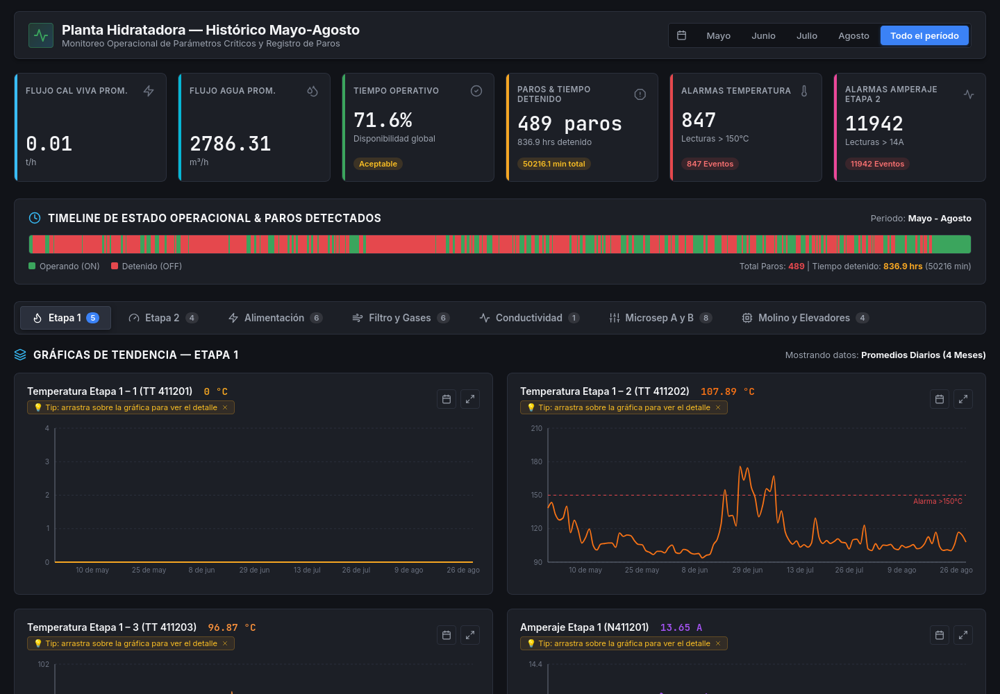

# Dashboard histórico — Planta hidratadora de cal

Dashboard web para analizar cuatro meses (mayo–agosto) de lecturas del historiador de una planta hidratadora de cal: 34 señales de proceso, paros detectados y KPIs de operación por mes.



## Qué problema resuelve

Los datos llegan como cuatro exportaciones `.xls` del historiador de planta (una por mes, 36 columnas, una lectura cada 10 minutos, unas 12.500 filas en total). En Excel es difícil responder las preguntas que importan en operación: ¿cuánto tiempo estuvo detenida la planta?, ¿cuándo?, ¿qué variables se salieron de rango?

El dashboard reúne todo en una sola vista:

- **KPIs por mes o del período completo:** disponibilidad, número de paros, horas detenidas, flujos promedio y conteo de alarmas (temperatura > 150 °C, amperaje de la etapa 2 > 14 A).
- **Línea de tiempo de operación** con cada paro detectado (inicio, fin y duración al pasar el cursor).
- **34 gráficas de tendencia** agrupadas en 7 pestañas (Etapa 1, Etapa 2, Alimentación, Filtro y gases, Conductividad, Microsep A/B, Molino y elevadores), con líneas de umbral, filtro por día, zoom arrastrando sobre la gráfica y vista ampliada.

## Stack

- **Frontend:** React 18 + Vite 5, Recharts para las gráficas y lucide-react para los íconos.
- **ETL:** Node.js con [SheetJS (`xlsx`)](https://sheetjs.com/) en `scripts/processData.js`.
- **Despliegue:** sitio estático (sin backend); `npm run build` genera `dist/`, listo para Netlify o cualquier hosting estático.

## Cómo correrlo

Requiere Node.js 18 o superior.

```bash
npm install
npm run process-data   # lee Data_May..August.xls y genera los JSON en src/data/
npm run dev            # abre el dashboard en http://localhost:5173
```

Para generar la versión de producción:

```bash
npm run build
npm run preview
```

`src/data/` ya incluye los JSON generados, así que `npm run dev` funciona aunque no se corra el ETL. Solo hay que volver a ejecutar `npm run process-data` si cambian los `.xls`.

## Estructura

```
├── Data_May.xls … Data_August.xls   # exportaciones crudas del historiador
├── scripts/processData.js           # ETL: Excel → JSON agregados
├── src/
│   ├── data/                        # salida del ETL (la consume el frontend)
│   ├── components/                  # Header, KpiCard, DowntimeTimeline, ChartPanel, ExpandModal
│   └── App.jsx                      # KPIs, pestañas y configuración de las 34 señales
└── docs/captura-dashboard.png
```

## Decisiones técnicas

**Paro = hueco de más de 15 minutos sin lecturas.** La exportación no trae una señal de marcha/paro, pero el historiador registra cada 10 minutos mientras la planta opera. Cuando entre dos lecturas consecutivas pasan más de 15 minutos (es decir, falta al menos una muestra), el ETL registra un paro desde la última lectura hasta la siguiente. El umbral está en la constante `GAP_THRESHOLD_MINUTES` para ajustarlo fácilmente.

**Agregados precalculados.** El navegador nunca lee Excel: el ETL corre una sola vez y escribe en `src/data/`:

| Archivo | Contenido | Se usa en |
|---|---|---|
| `kpis_by_month.json` | KPIs y estadísticas (promedio, mín., máx.) por mes y del período | Tarjetas de KPI |
| `downtime.json` | Lista de paros con inicio, fin y duración | Línea de tiempo |
| `readings_daily.json` | Promedio diario por señal | Gráficas con "Todo el período" |
| `readings_hourly.json` | Promedio horario por señal | Gráficas de un mes |
| `readings_raw.json` | Lecturas originales cada 10 min | Zoom y detalle de un día |

Así cada vista dibuja solo los puntos que necesita (unos 110 por señal para el período completo y entre 450 y 670 para un mes) y los cálculos pesados no se repiten en cada render.

**Disponibilidad** = 1 − (minutos detenidos / minutos calendario del mes).

**Alarmas:** se cuenta cada lectura por encima del umbral (> 150 °C en cualquiera de los seis sensores de temperatura del hidratador; > 14 A en el motor de la etapa 2).

## Autor

**John Neider Cuervo Quintero** — estudiante de Ingeniería de Software y Datos, Medellín.
Portafolio: [portafolio-john-cuervo.netlify.app](https://portafolio-john-cuervo.netlify.app/)
